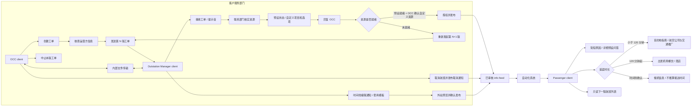

# Development graph 与 guidance 核对

核对基准：用户于 2026-11-15 提供的流程图及本轮文字要求。当前为本机演示系统。

## 业务与数据方向

OCC client 和 Outstation Manager client 同属客户服务部门。自动化系统在业务上与其平级，只读取客服审核后发布的 feed，再呈现给 passenger client；乘客页不回写员工工单、选择航班或执行改签。当前演示在同一 FastAPI 进程中通过已发布读模型实现这条边界，并非独立部署的多个服务。

重新发起继承该航班已经核查的运营方信息和上一版项目，并要求外站重新回答；一个航班保留多个工单版本，同时最多一个活动版本。首次创建并发送时，前后端均要求核查运营方信息。

## 逐项对照

| 要求 | 当前实现与验证 |
|---|---|
| 创建 → 核查运营方 → 发送 | 两步表单；未核查时按钮禁用，API 拒绝发送 |
| 外站接收、部门核实与反馈 | 接收后填写预设项目；部门沟通在线下进行，系统记录其确认结果和备注 |
| 项目和选项完全自定义 | 外站可自由填写名称、2–6 个唯一选项并选择回答；不把任意自定义回答自动解释为 Ready |
| 资源就绪才授权发布 | 所有预设项目须 Ready；含自定义项目时 OCC 须确认其回答符合要求，并记录在授权事件中 |
| 未就绪 → 下一版工单 | 授权磁贴禁用，下一步提示重新发起；API 同样拒绝发布，重发保留旧版和之前答案 |
| 中止与取消分别处理 | 中止仅停止本版工单；取消关闭航班事件、停止活动工单并发布取消通知 |
| Word / PDF 等附件 | OCC / 所属外站双向上传下载；不向乘客 feed 发送内部附件 |
| 提示音 | Web Audio；外站提供明显开关，新到工单有提示。浏览器要求先有用户手势；静音时仍有视觉提醒 |
| 单向审核 feed | 公开读模型仅传已发布状态、原因、时间、登机口和历史；内部回答、备注、附件不进入乘客 API |
| 原因简短 + 直接到 chatbot | 主卡一段简短说明和“问出行助手”；详情、行动建议与问题在固定双语助手中 |
| 短延误推广 | 原定与公布起飞时间差 <120 分钟时展示目的地内容与航空公司／铁路官网推广 |
| 长延误候机服务 | 延误 ≥120 分钟时优先显示出发机场餐饮与商店目录；目的地指南折叠后仍可访问 |
| 时间待定 | OCC 可发布原因及“起飞时间待确认”；员工与乘客主时钟均显示待定，中转可行性显示待确认 |
| 转机只读 | 没有选择、预订或改签按钮；标识原订航班、已起飞、取消、衔接不足、可衔接和待确认 |
| 动态状态 | 时钟每 15 秒重新判断，GET 每 30 秒刷新并结合 SSE；已起飞／取消单独标识；可用中转时间 ≤30 分钟为红色，>30 且 <60 为黄色，≥60 为绿色；时间待定保持中性 |
| OCC PC / 外站 PC+手机 / 乘客 PC+手机 | 更大操作磁贴、资源卡和点击区；加强文字及边界对比；保留可调侧栏与手机单列布局 |

## 本轮修正

1. 移除转机选择状态、按钮及“选择其他航班／出示选中航班”等文本。
2. 把长短延误分流逻辑集中到 `frontend/src/passengerGuidance.js`，默认阈值 120 分钟。
3. 增加七个出发机场的官方餐饮／商业目录，依据 station 而不是抵达的 HKG 选择。
4. 阻止资源未就绪时授权发布；自定义资源保留人工判断，增加明确确认及审计记录。
5. 支持延误时间待定，避免继续展示旧建议时间或误算可衔接航班。登机发布仍须明确起飞时间。
6. 主原因卡精简，详细解释进入助手；放大磁贴和控件、提高对比，并修复手机航班时间折行。

## 演示与真实服务边界

后续需求增加了外站独立发布乘客通知的入口：时间线事件 → 编辑或模板 → 双语预览 → 确认发布。外站作为客服部门的一部分直接审核自己的通知，发布仍受 OCC 的暂停开关控制；通知存为独立的 `general` 历史，运行状态继续由 OCC 的工单授权／取消流程管理。内部源事件保留，重复请求幂等，再次编辑可带回已发布文案。

“下一程”当前来自合成时刻表，随当前时间自动更新可行性，并支持上游取消状态、修正的预计起飞时间；尚未接入真实航空公司或机场航班状态 API。页面明确标注演示时刻表。真实实时航班数据需接入可用的数据源，不能把本机时钟推算宣称为真实运行状态。

助手使用固定中英文说明和问答，不调用外部 LLM。机场目录是官网外链，不提供店铺实时营业、步行导航、库存、餐券或商业优惠保证。员工部门联系和实际退改签仍由真实工作人员完成。

验证记录及截图见 [VERIFICATION.md](../VERIFICATION.md)。

## 2026-11-15：朋友实现功能整合

详见 [逐项整合表](friend-feature-integration.md)。独立地面任务、自由消息、Customer Care、通知排程和召回均接入服务端；正式工单流程保持创建 → 核查运营方 → 发送 → 接收/回复 → OCC 审核 → 授权发布。外站任务状态更新及自定义任务不会绕过此流程。后续航班保持只读和用户规定的30/60分钟阈值。此前“仅7外站”的范围现扩展为11外站，可选加载朋友的30个双向UO演练航班。
